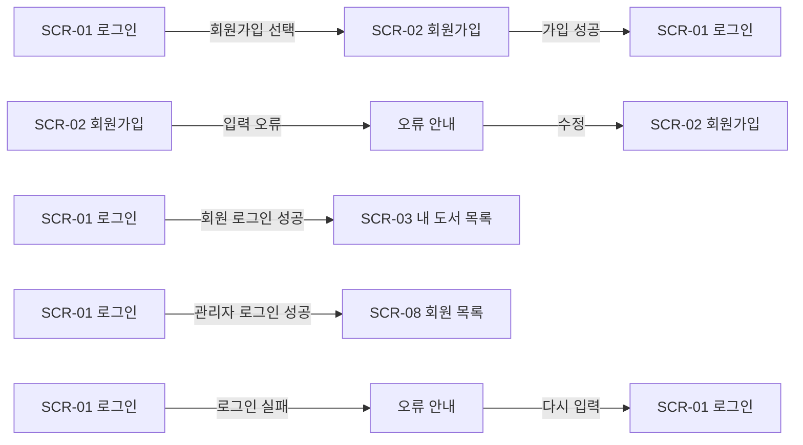
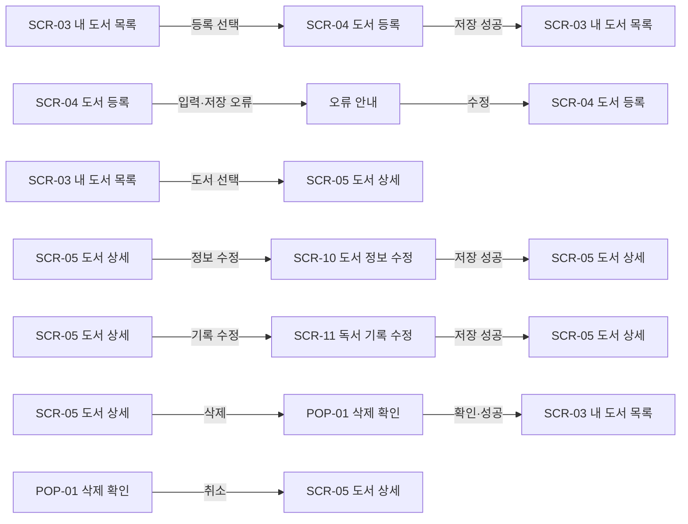
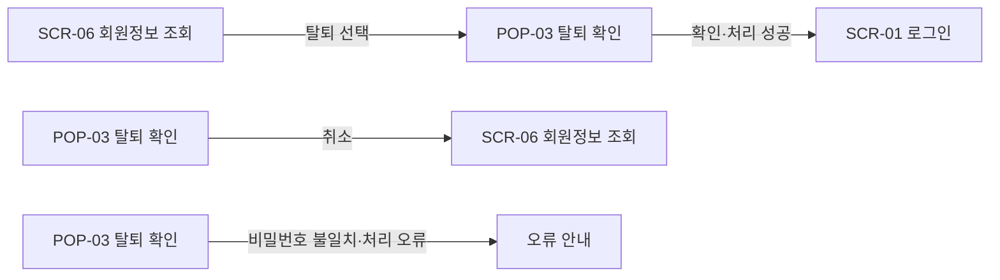
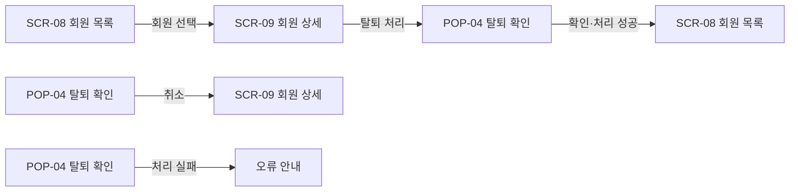
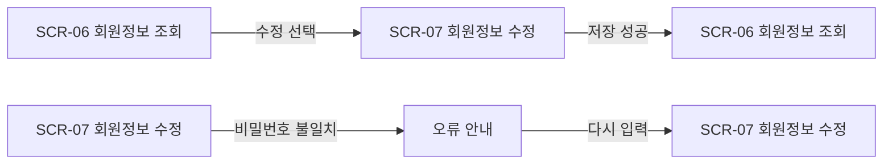
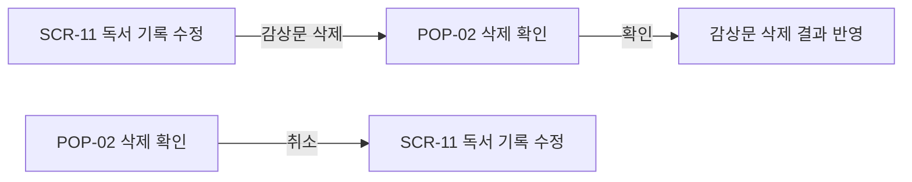

# 개인 독서 기록 웹서비스 — 화면 목록 및 이동 흐름

| 항목 | 내용 |
| --- | --- |
| 문서 버전 | v1.0 |
| 작성자 | 정원재 |
| 작성일 | 2026-11-13 |
| 문서 목적 | 서비스의 화면 목록과 주요 사용자 이동 흐름을 정리한다. |
| 관련 화면 | [Figma 화면 설계서](https://www.figma.com/design/tmFU3v51azApeajGWcxRGD/?node-id=11-2) |
| 관련 요구사항 | [요구사항 및 기능명세서](https://github.com/jackie020105-beep/WebJava_Project_BOOKLOG/tree/main/docs/00_SRS) |

## 목차

1. 수정 이력
2. 정보 구조 및 화면 목록
3. 주요 화면 이동 흐름
4. 화면 이동 플로우차트
5. 구현 설계 시 확인 사항

## 1. 수정 이력

| 버전 | 작성일 | 내용 | 작성자 |
| --- | --- | --- | --- |
| v1.0 | 2026-11-13 | 화면 목록, 확인창과 주요 화면 이동 흐름 정리 | 정원재 |

## 2. 정보 구조 및 화면 목록

화면별 구성 요소와 상세 동작은 Figma 화면 설계서를 참고한다. 화면은 현재 초안이며 목록은 Figma의 배치 순서를 따른다. 화면 ID는 기존 번호를 유지한다.

### 정보 구조

- 로그인 전: 로그인, 회원가입
- 회원: 내 도서 목록, 도서 등록, 도서 상세, 도서 정보 수정, 독서 기록 수정, 회원정보 조회·수정
- 관리자: 회원 목록, 회원 상세 및 탈퇴 처리

### 기본 화면 목록

| 화면 ID | 화면명 | 사용자 | 용도 | Figma |
| --- | --- | --- | --- | --- |
| SCR-01 | 로그인 | 로그인 전 사용자 | 회원과 관리자 로그인 | [화면 보기](https://www.figma.com/design/tmFU3v51azApeajGWcxRGD/?node-id=38-2) |
| SCR-02 | 회원가입 | 비회원 | 일반 회원 계정 생성 | [화면 보기](https://www.figma.com/design/tmFU3v51azApeajGWcxRGD/?node-id=38-4) |
| SCR-03 | 내 도서 목록 | 회원 | 본인 도서 검색·필터 및 목록 조회 | [화면 보기](https://www.figma.com/design/tmFU3v51azApeajGWcxRGD/?node-id=38-7) |
| SCR-04 | 도서 등록 | 회원 | 도서 정보와 표지 등록 | [화면 보기](https://www.figma.com/design/tmFU3v51azApeajGWcxRGD/?node-id=38-8) |
| SCR-05 | 도서 상세 및 독서 기록 | 회원 | 도서와 독서 기록 조회 | [화면 보기](https://www.figma.com/design/tmFU3v51azApeajGWcxRGD/?node-id=38-9) |
| SCR-10 | 도서 정보 수정 | 회원 | 도서 기본 정보와 표지 수정 | [화면 보기](https://www.figma.com/design/tmFU3v51azApeajGWcxRGD/?node-id=38-11) |
| SCR-11 | 독서 기록 수정 | 회원 | 독서 상태·날짜·별점·감상문 관리 | [화면 보기](https://www.figma.com/design/tmFU3v51azApeajGWcxRGD/?node-id=38-12) |
| SCR-06 | 회원정보 조회 | 회원 | 본인 정보 확인 및 탈퇴 진입 | [화면 보기](https://www.figma.com/design/tmFU3v51azApeajGWcxRGD/?node-id=38-14) |
| SCR-07 | 회원정보 수정 | 회원 | 본인 회원정보 변경 | [화면 보기](https://www.figma.com/design/tmFU3v51azApeajGWcxRGD/?node-id=38-16) |
| SCR-08 | 관리자 회원 목록 | 관리자 | 일반 회원 목록 및 검색 | [화면 보기](https://www.figma.com/design/tmFU3v51azApeajGWcxRGD/?node-id=38-18) |
| SCR-09 | 관리자 회원 상세 | 관리자 | 일반 회원 정보 조회 및 탈퇴 처리 | [화면 보기](https://www.figma.com/design/tmFU3v51azApeajGWcxRGD/?node-id=38-19) |

### 확인창 목록

| 화면 ID | 확인창 | 진입 화면 | 확인 시 | 취소 시 |
| --- | --- | --- | --- | --- |
| POP-01 | [도서 삭제](https://www.figma.com/design/tmFU3v51azApeajGWcxRGD/?node-id=38-10) | SCR-05 | 도서와 관련 기록 삭제 후 SCR-03 이동 | 기존 도서 유지 |
| POP-02 | [감상문 삭제](https://www.figma.com/design/tmFU3v51azApeajGWcxRGD/?node-id=38-13) | SCR-11 | 감상문만 삭제하고 결과 반영 | 기존 감상문 유지 |
| POP-03 | [회원 본인 탈퇴](https://www.figma.com/design/tmFU3v51azApeajGWcxRGD/?node-id=38-15) | SCR-06 | 현재 비밀번호 검증 후 탈퇴, SCR-01 이동 | 기존 회원정보 유지 |
| POP-04 | [관리자의 회원 탈퇴 처리](https://www.figma.com/design/tmFU3v51azApeajGWcxRGD/?node-id=38-20) | SCR-09 | 일반 회원 탈퇴 처리 후 SCR-08 이동 | 기존 회원정보 유지 |

### 입력 상태 화면

| 대상 화면 | 상태 | 표시 조건과 안내 문구 | Figma |
| --- | --- | --- | --- |
| SCR-01 로그인 | 상태 01 | 인증 정보 불일치: 아이디 또는 비밀번호가 일치하지 않습니다. | [화면 보기](https://www.figma.com/design/tmFU3v51azApeajGWcxRGD/?node-id=38-3) |
| SCR-02 회원가입 | 상태 02-1 | 아이디 중복 또는 입력 조건 불일치: 사용할 수 없는 아이디입니다. | [화면 보기](https://www.figma.com/design/tmFU3v51azApeajGWcxRGD/?node-id=38-5) |
| SCR-02 회원가입 | 상태 02-2 | 아이디 형식과 중복 검사 통과: 사용할 수 있는 아이디입니다. | [화면 보기](https://www.figma.com/design/tmFU3v51azApeajGWcxRGD/?node-id=38-6) |
| SCR-07 회원정보 수정 | 상태 07 | 현재 비밀번호 불일치: 현재 비밀번호가 일치하지 않습니다. | [화면 보기](https://www.figma.com/design/tmFU3v51azApeajGWcxRGD/?node-id=38-17) |

아이디 검사 시점은 화면 설계에서 검토 중이다.

## 3. 주요 화면 이동 흐름

- 로그인 성공 시 회원은 SCR-03, 관리자는 SCR-08로 이동한다. 로그인 실패 시 오류를 안내한다.
- 회원가입 성공 시 SCR-01로 이동한다. 필수 정보 누락이나 검증 오류 시 안내한다.
- 회원가입 시 아이디가 중복되거나 입력 조건에 맞지 않으면 ‘사용할 수 없는 아이디입니다.’라고 안내한다. 형식과 중복 검사를 모두 통과하면 사용 가능한 아이디로 안내한다.
- 회원은 SCR-03에서 도서 등록 또는 도서 상세로 이동한다. 도서 상세에서 정보 수정, 독서 기록 수정, 삭제를 선택할 수 있다.
- 회원은 SCR-06에서 본인 정보를 확인하고 수정하거나 회원탈퇴를 선택할 수 있다.
- 관리자는 SCR-08에서 일반 회원을 검색·선택하고 SCR-09에서 상세 조회 또는 탈퇴 처리할 수 있다.
- 도서 목록·검색·필터 결과는 최근 등록순으로 페이지당 최대 4권을 표시한다. 회원 목록은 최근 가입순으로 페이지당 10명이다.
- 독서 날짜는 선택 사항이며 완독일은 ‘읽은 후’일 때만 입력한다. 달력에서 미래 날짜, 시작일보다 빠른 완독일, 완독일보다 늦은 시작일은 선택할 수 없다. 시작일과 완독일이 같은 날인 경우는 허용한다. 서버에서도 날짜를 검증한다.

## 4. 화면 이동 플로우차트

동일한 화면이 여러 줄에 나타나는 것은 선을 꺾지 않고 각 경우를 따로 표시하기 위해서다.

### 4.1 회원가입과 로그인

### 4.2 도서 등록과 관리

### 4.3 회원 본인 탈퇴

본인 탈퇴는 현재 비밀번호를 확인한 후 처리한다.

### 4.4 관리자 회원 관리

### 4.5 회원정보 조회와 수정

### 4.6 감상문 삭제

## 5. 구현 설계 시 확인 사항

- 아이디 형식·중복 검사와 사용 가능 안내를 표시할 시점
- 서버 재시작 후 로그인 상태 유지 여부와 구현 방식
- 이미지 파일 삭제에 실패한 경우 재시도 시점과 횟수
- Figma 도서 정보 수정 화면에서 표지 이미지 삭제 선택 방식 보완
